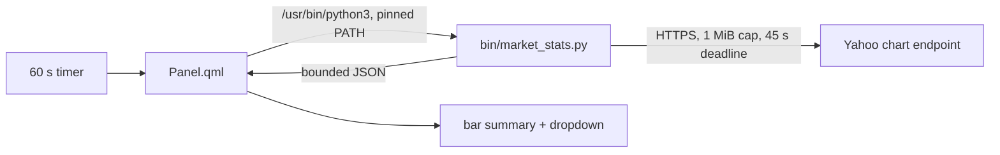

<p align="center">
  <picture>
    <source media="(prefers-color-scheme: dark)" srcset="assets/brand/wordmark-dark.svg">
    
  </picture>
</p>

<p align="center"><strong>A fixed market watchlist in the Omarchy bar, one key from TradingView.</strong></p>

> Logo is a proposal pending owner sign-off. Screenshot: TODO, a real capture of the bar and panel (roadmap U1); the current `preview.png` does not match the code.

`lukedaduke.ticker` is an Omarchy bar widget. The bar shows a short summary; the dropdown lists 18 symbols (gold and miners, tech, nuclear, energy, rates) with price and daily change. Enter opens the selected symbol on TradingView.

## Install

```bash
omarchy plugin add https://github.com/duketopceo/omarchy-ticker
omarchy plugin enable lukedaduke.ticker
```

Requires `python3`, `xdg-open`, and HTTPS access to `query1.finance.yahoo.com`.

## Use

| Input | Action |
|---|---|
| Left click on the bar icon | refresh and open the panel |
| Right click | open gold on TradingView |
| `j` / `k` | move selection |
| Enter or click a row | open that symbol on TradingView |
| Esc | close |

The status chip shows `syncing`, the last update time, or `stale <time>` when the latest refresh failed and the previous quotes are still shown.

## How it works



The helper is stdlib-only. It refuses non-HTTPS redirects, caps each response at 1 MiB, strips control characters from remote text, and the panel keeps the last good snapshot if a refresh fails.

## Symbols

Hardcoded in `TICKERS` in `bin/market_stats.py`. Making them configurable is roadmap U4.

## Status

See [ROADMAP.md](ROADMAP.md), [DESIGN.md](DESIGN.md) and the [landscape note](docs/research/2026-10-11-landscape.md). Quotes come from an unofficial Yahoo endpoint with no published terms; it can change without notice.

## Contributing

This repo is the published subtree of [`duketopceo/omarchy-plugins`](https://github.com/duketopceo/omarchy-plugins) (`plugins/lukedaduke.ticker/`). Changes should be made there; direct commits here are overwritten on the next publish.

## Remove

```bash
omarchy plugin disable lukedaduke.ticker
omarchy plugin remove lukedaduke.ticker
```

## License

MIT
